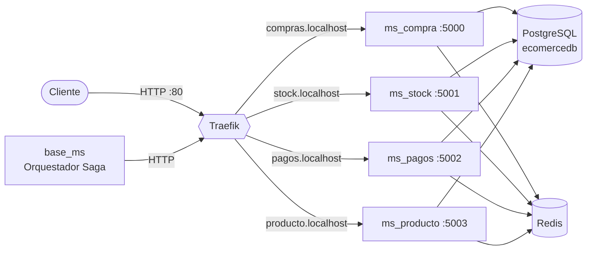

# servicios

Infraestructura compartida del e-commerce basado en microservicios: **Traefik** como API gateway / reverse proxy y **Redis** para caché, locks distribuidos y rate limiting. Es lo primero que hay que levantar, antes que cualquier microservicio.

- **Stack:** Traefik v2.10 · Redis 7.0 · Docker Compose

---

## Ecosistema

Este repositorio forma parte de un conjunto de repos que funcionan juntos:

| Repositorio | Rol | Puerto | Host vía Traefik |
|---|---|---|---|
| **[servicios](https://github.com/maxi627/servicios)** (este repo) | Infraestructura: Traefik (API gateway) y Redis | 80 / 443 / 8080 · 6379 | — |
| [base_ms](https://github.com/maxi627/base_ms) | PostgreSQL compartida (`ecomercedb`) + orquestador Saga | 5432 · 5005 | — |
| [ms_producto](https://github.com/maxi627/ms_producto) | Catálogo de productos | 5003 | `producto.localhost` |
| [ms_stock](https://github.com/maxi627/ms_stock) | Movimientos de inventario | 5001 | `stock.localhost` |
| [ms_pagos](https://github.com/maxi627/ms_pagos) | Registro de pagos | 5002 | `pagos.localhost` |
| [ms_compra](https://github.com/maxi627/ms_compra) | Registro de compras | 5000 | `compras.localhost` |



Todos los contenedores se comunican por la red Docker externa **`red1`**.

### Levantar todo el ecosistema

```bash
# 1. Red compartida (una sola vez)
docker network create red1

# 2. Infraestructura: Redis y Traefik (este repo)
cd servicios
docker compose -f docker-compose.redis.yml up -d
docker compose -f docker-compose.traefik.yml up -d

# 3. Base de datos PostgreSQL
cd ../base_ms
docker compose up -d

# 4. Microservicios (cada uno con su propio .env)
cd ../ms_producto && docker compose -f docker-compose.producto.yml up -d --build
cd ../ms_stock    && docker compose -f docker-compose.stock.yml up -d --build
cd ../ms_pagos    && docker compose -f docker-compose.pagos.yml up -d --build
cd ../ms_compra   && docker compose -f docker-compose.compra.yml up -d --build
```

Si los hosts `*.localhost` no resuelven en tu sistema, agregalos al archivo `hosts` apuntando a `127.0.0.1`.

---

## Traefik

`docker-compose.traefik.yml` levanta Traefik v2.10 (contenedor `traefik`):

| Puerto | Uso |
|---|---|
| `80` | Entrypoint `web` (HTTP) |
| `443` | Entrypoint `websecure` (HTTPS) |
| `8080` | Dashboard: <http://localhost:8080> |

- Usa el **proveedor Docker**: lee el socket `/var/run/docker.sock` y descubre los microservicios por sus `labels`.
- Cada microservicio declara su router en su propio compose, por ejemplo:

  ```yaml
  labels:
    - "traefik.enable=true"
    - "traefik.http.routers.ms-compras.rule=Host(`compras.localhost`) && PathPrefix(`/api/v1`)"
    - "traefik.http.services.ms-compras.loadbalancer.server.port=5000"
  ```

- Si un servicio tiene varias réplicas (`deploy.replicas`), Traefik balancea la carga entre ellas.
- El dashboard y la API están en modo inseguro (`--api.insecure=true`) y el log en `DEBUG`: es una configuración para desarrollo.

### HTTPS con certificados locales (en progreso)

- `traefik.yml` es una configuración alternativa que solo expone los servicios con `traefik.enable=true` (`exposedByDefault: false`) y usa un certificado por defecto para TLS.
- En `certs/` está el `openssl-san.cnf` usado para generar el certificado de `stock.localhost` / `localhost`.
- Al final de `docker-compose.traefik.yml` hay una versión comentada que monta `traefik.yml` y `certs/`. La idea es terminar de probarla con certificados generados con [mkcert](https://github.com/FiloSottile/mkcert).

## Redis

`docker-compose.redis.yml` levanta Redis 7.0 (contenedor `redis_service`, puerto `6379`), protegido con contraseña (`--requirepass`).

Los microservicios lo usan para tres cosas:

| Uso | Ejemplo de clave |
|---|---|
| Caché de consultas (Flask-Caching) | `flask_compras`, `flask_producto_1` |
| Locks distribuidos para evitar escrituras concurrentes (`SET NX` con expiración) | `stock_lock_1` |
| Contadores del rate limiting (Flask-Limiter), compartidos entre réplicas | — |

## Configuración

Crear un archivo `.env` en la raíz del repo:

```env
REDIS_PASSWORD=cambiar
```

La misma contraseña tiene que estar en el `.env` de cada microservicio, junto con `REDIS_HOST=redis_service` y `REDIS_PORT=6379`.

## Pendientes

- Terminar la configuración de HTTPS con certificados de mkcert para pruebas locales.
- Mover el circuit breaker a Traefik (middleware `circuitBreaker`) en lugar de implementarlo como librería en [base_ms](https://github.com/maxi627/base_ms).
